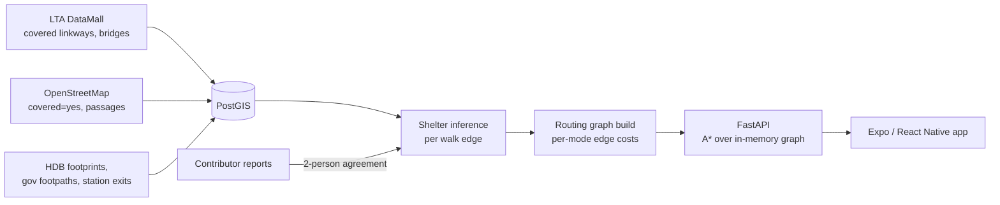

# Coway Map

**Rain-aware walking navigation for Singapore.** Routes prefer covered walkways, void decks, underground MRT links and building corridors over the shortest path.

[**Download on the App Store →**](https://apps.apple.com/sg/app/id6762112220)


> The source code is private. This repo documents how the product works.

---

## What it does

- **Three routing modes:** `fastest`, `balanced`, `sheltered`, with turn-by-turn steps that mark sheltered and exposed segments.
- **Transit:** MRT/LRT and bus journeys, with walk legs that start at the right station exit.
- **Weather:** NEA rain-area overlay, area forecasts, rain alerts for saved places, and PUB flood alerts.
- **Accounts:** Sign in with Apple via Supabase, saved places, notification preferences, account deletion.
- **Crowdsourced corrections:** contributors report shelter on a segment, and a claim reaches the routing graph only after two independent contributors agree or an admin approves it.

Example: Funan → Suntec City takes **17 min with 97% under cover**, against 16 min and 35% on the fastest route.

## How it works



### Shelter inference

Each walk edge gets a `protection_score` in two passes:

1. **Polygon pass:** the share of the edge under an LTA or OSM shelter polygon. 80% or more counts as fully covered, 50% or more as high.
2. **Rule pass:** for the rest, OSM tags (`indoor`, `underground`, `covered=yes`, `tunnel=building_passage`) and proximity rules for crossings, steps, buildings and stations.

### Cost model

```
cost = walk_time
     + walk_time × exposure_weight × (1 − protection_score)
     + crossing / stairs penalties
     + confidence_penalty × (1 − confidence) × walk_time
```

| Mode | exposure_weight |
|------|-----------------|
| fastest | 0.0 |
| balanced | 0.5 |
| sheltered | 2.0 (an exposed edge costs about 3× its walk time) |

Physical crossing wait and mode preference are kept as separate terms, so the `fastest` mode still reflects real waiting time at crossings.

### Stations as portals

Underground MRT interiors aren't available as open data, so each station is modelled as a **black-box portal**: its exits (949 across the network) are joined through a virtual concourse, letting a route pass *through* a station under cover. Exits more than 300 m from the station centroid are dropped, which stops stations that share a name from producing multi-km "teleport" links. Portals are time-aware, so routes never use a passage that is closed.

## By the numbers

| | |
|---|---|
| Routable walk graph | ~15,467 km (89% island coverage) |
| Covered network | ~1,236 km: LTA 685.5 km · OSM 498.5 km · HDB 51.9 km |
| Tagged crossings | ~27,672 |
| MRT/LRT exits modelled | 949 |
| Tests | 150+ test files (pytest backend, Jest mobile) |
| CI | GitHub Actions: ruff, pytest, ESLint, `tsc --noEmit`, production build |

**Data provenance:** every covered segment keeps the source it came from. Today the covered network comes from public datasets. The field-verification pipeline runs end to end, and walked-and-confirmed coverage is the next goal.

## Engineering notes

- **Keeping spatial queries on the index.** Proximity checks originally cast to `::geography`, which bypassed the GIST index and timed out at ~71k edges. Switching to geometry `ST_DWithin` with a degree threshold (`metres / 111320`) kept them on the index.
- **Bulk footpath import.** About 110k government footpaths are filtered to those within ~5 m of a covered linkway, then deduplicated on a ~2 m in-memory grid and bulk-inserted. This replaced a slow per-node importer.
- **The graph is a build artifact.** Changing a cost or shelter attribute triggers a rebuild and a warm-cache refresh, not a live config edit.

## Stack

**Backend:** Python, FastAPI, SQLAlchemy, PostgreSQL/PostGIS, Supabase, Railway
**Mobile:** TypeScript, React Native (Expo), MapLibre / Mapbox
**Web:** Next.js, MapLibre GL JS
**Data:** LTA DataMall, OneMap, OpenStreetMap, data.gov.sg (NEA), PUB

## Attribution

Map and transit data © OneMap / SLA, © OpenStreetMap contributors, LTA DataMall, data.gov.sg, © Mapbox.

---

Built solo by [Heesu Kim](https://github.com/brian7942) with AI-assisted development.
